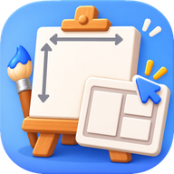

<p align="center">
  
</p>

<h1 align="center">캔버스 호수 계산기</h1>

<p align="center">
  캔버스 호수 ↔ 실제 크기 변환부터<br>
  전시 벽면 작품 배치까지, 한곳에서 해결해요.
</p>

<p align="center">
  <a href="https://dalyeoneo-cmd.github.io/canvas-ho/"><b>▶ 바로 쓰기</b></a>
  &nbsp;·&nbsp;
  설치 없이 PC·휴대폰 브라우저에서 바로 열려요
</p>

<br>

## 이럴 때 쓰면 좋아요

- 10호 F가 몇 cm였는지 또 헷갈릴 때
- 줄자로 잰 캔버스가 몇 호인지 궁금할 때
- 전시 벽 4m에 10호를 몇 점까지 걸 수 있는지 계산할 때
- 크기가 다른 작품들을 어떻게 걸지 미리 그려보고 싶을 때

<br>

## 기능 한눈에 보기

| 탭 | 하는 일 |
| :-- | :-- |
| **호수표** | 0호~500호 표준 규격을 F·P·M·S 형태별로 봐요 |
| **호수 → 크기** | 호수를 고르면 cm·인치 크기가 나오고, 작품 캡션을 복사할 수 있어요 |
| **크기 → 호수** | 잰 크기를 넣으면 몇 호인지, 표준과 얼마나 다른지 알려줘요 |
| **배치** | 같은 크기 작품이 벽에 몇 점 들어가는지 계산해요 |
| **커스텀 배치** | 크기가 다른 작품을 섞어서 줄 맞춰 걸거나 자유롭게 옮겨봐요 |

<br>

## 이런 것도 돼요

**크기와 모양**
- 액자 프레임 폭과 안쪽 여백(프레임과 캔버스 사이)까지 넣어서 계산해요
- 규격에 없는 캔버스는 크기와 모양(사각형·원·육각형·다이아)을 직접 넣어요
- 벽 크기는 cm와 mm 중 편한 단위로 넣어요

**배치 도우미**
- 작품 가운데를 눈높이(바닥에서 150cm)나 벽 가운데에 맞춰요
- 작품끼리 중심선·윗선·아랫선을 맞춰요
- 자유 배치에서는 끌어서 옮기면 벽 끝·가운데·다른 작품 선에 자석처럼 붙어요
- 작품을 누르면 벽 끝에서의 거리와 바닥에서의 높이가 나와서 실제로 걸 때 그대로 재면 돼요

**미리보기와 저장**
- 내 작품 사진을 넣어 벽에 걸린 모습을 미리 봐요
- 치수가 표시된 배치도를 PNG 이미지로 저장해요
- 다크 모드와 휴대폰 화면도 지원해요

> 자세한 사용법은 프로그램 오른쪽 위 **사용법** 버튼에 있어요.

<br>

## 알아두세요

- 호수표는 **국내 화방 표준 규격(cm)** 기준이에요. 제조사마다 몇 mm씩 다를 수 있으니 정확한 값은 실측을 우선해 주세요.
- 넣은 사진은 **어디에도 올라가지 않아요.** 브라우저 안에서만 쓰이고 새로고침하면 사라져요.
- 눈높이 150cm는 전시에서 흔히 쓰는 기준이에요. 공간에 맞게 조정해서 써주세요.

<br>

## 만든 사람

**달연어 (Dal Yeon-eo)** · 미술 작가

전시를 준비할 때마다 캔버스 호수를 헷갈리고, 벽 길이를 재며 몇 점을 걸 수 있을지 계산하는 게 번거로워서 만들었어요. 무료로 자유롭게 써주세요.

링크로 소개하거나, 가져가서 고쳐 쓰거나 다시 공유할 때는 **출처(달연어)** 를 꼭 남겨주세요.

© 2026 달연어 (Dal Yeon-eo)

<br>

<details>
<summary><b>파일 구성 · 관리 정보</b></summary>

<br>

```
canvas-ho/
├── index.html             프로그램 전체 (화면·디자인·계산이 모두 이 파일 하나에 있어요)
├── README.md              이 설명 파일
└── icons/
    ├── favicon.ico        브라우저 탭 아이콘
    ├── icon-16 ~ 512.png  크기별 아이콘
    └── apple-touch-icon.png  아이폰 홈 화면 아이콘
```

- 내려받은 `index.html`을 브라우저로 열어도 똑같이 써져요.
- 글꼴은 Google Fonts(IBM Plex Sans KR, IBM Plex Mono, Noto Serif KR)를 불러와요. 인터넷이 안 되면 기본 글꼴로 보여요.
- 방문 통계는 `index.html` 맨 아래 GoatCounter 코드(`dalyeoneo-tools`)로 모아요. 필요 없으면 그 줄을 지우면 돼요.

</details>
